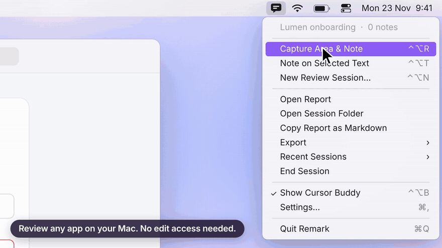
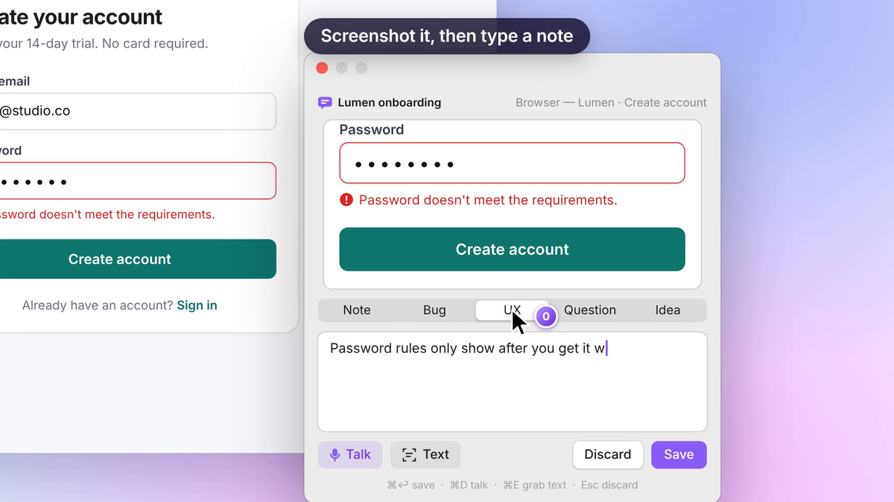
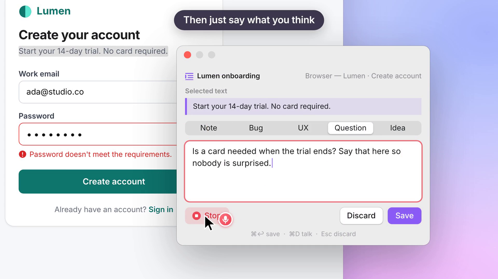
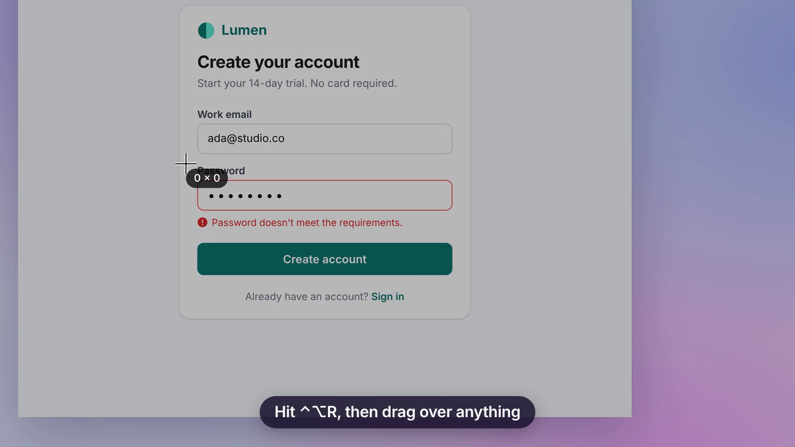
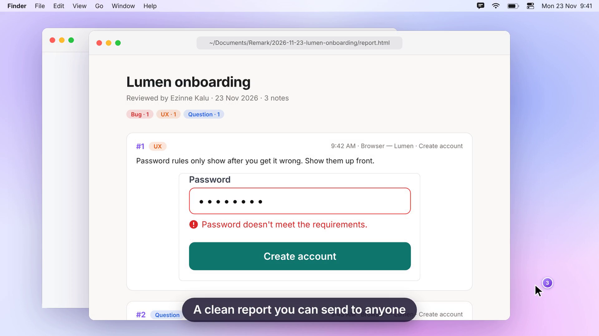
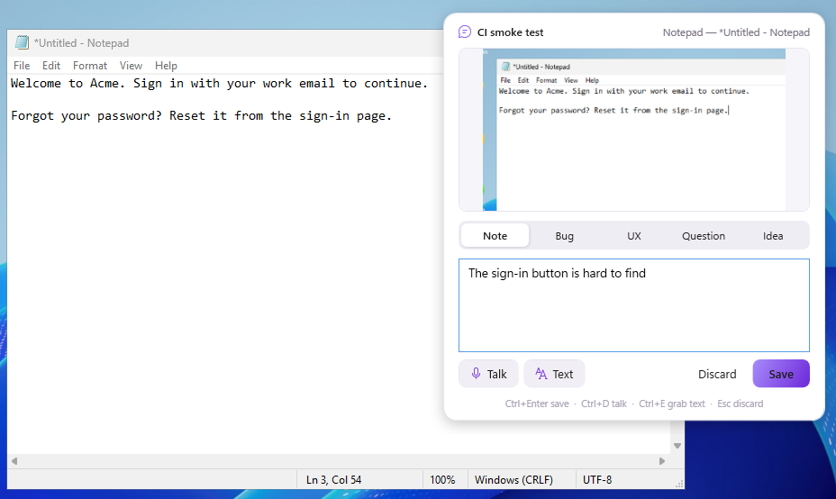
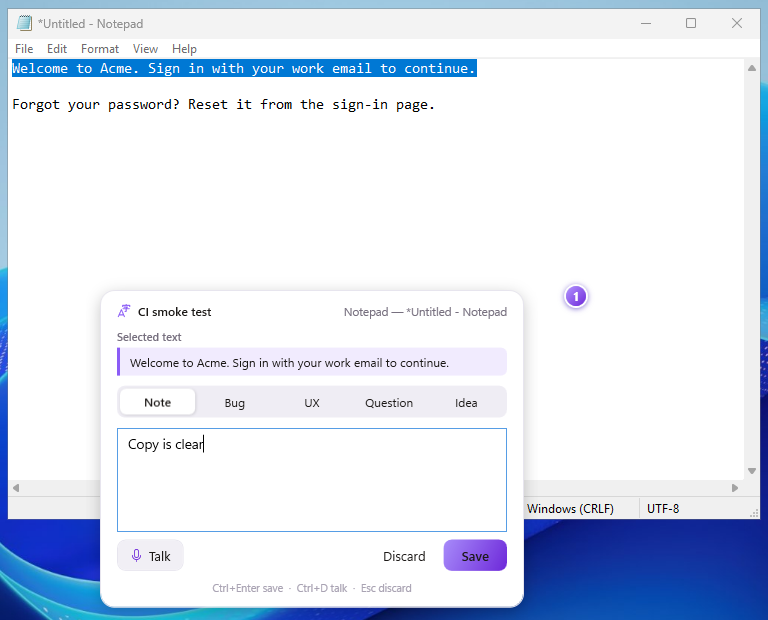
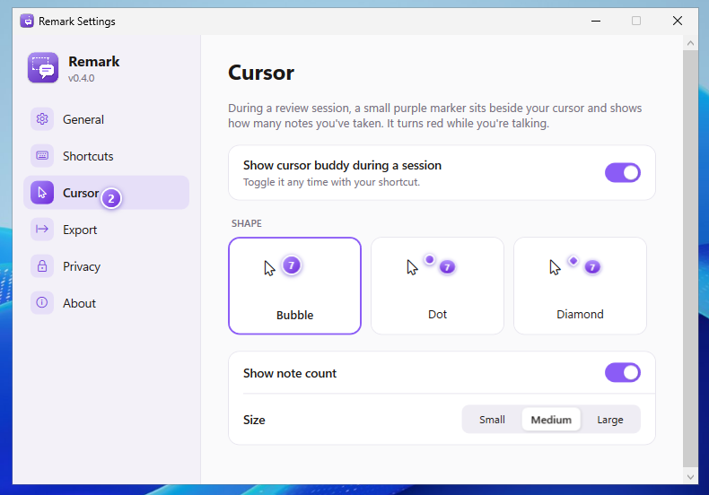
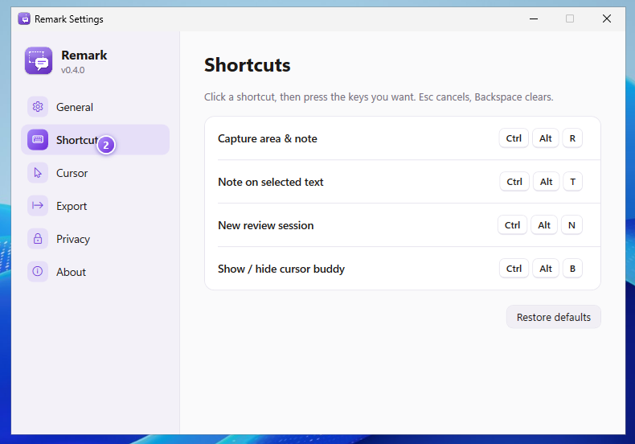

<p align="center">
  
</p>

<h1 align="center">Remark</h1>

<p align="center">
  <strong>Screenshot it. Say it. Send the report.</strong><br>
  Review anything on your screen, without needing edit access to someone else's doc, app, or tool.
</p>

<p align="center">
  <a href="../../releases/latest"></a>
  <a href="LICENSE"></a>
  
  
</p>

<p align="center">
  
</p>

---

Reviewing a friend's app onboarding, writing up bug bounty evidence, giving design feedback, checking someone's doc? Normally you'd need them to use Google Docs, give you edit access, or install their tool. **Remark** sits in your menu bar or system tray instead:

1. Press a shortcut and **drag over any part of the screen**, or **highlight text** in any app.
2. **Type or talk** your note. Tag it as a Bug, UX issue, Question or Idea.
3. Every note lands in a local **review session**. When you're done, **export a clean report** (PDF, HTML, Markdown, JSON or CSV) and send it to anyone.

A small purple bubble sits beside your cursor during a session, counting your notes. It turns red while you're talking.

## Screenshots

### macOS

| Select an area, then write a note | Highlight text, then talk |
|---|---|
|  |  |
| **Drag to select (⌃⌥R)** | **The report you send** |
|  |  |

### Windows

| Note on a screenshot | Note on selected text |
|---|---|
|  |  |
| **Cursor buddy settings** | **Every shortcut is yours to change** |
|  |  |

<sub>The Windows screenshots come straight from the automated end-to-end test, which drives the real app on a Windows desktop on every change.</sub>

## Install

**macOS 13+**: download `Remark-x.y.z.dmg` from [Releases](../../releases/latest), open it, and drag **Remark** into **Applications**.

> Builds aren't notarized yet, so macOS blocks the first launch. Open **System Settings → Privacy & Security** and click **Open Anyway**, or run `xattr -dr com.apple.quarantine /Applications/Remark.app`.

**Windows 10/11**: download `Remark-Setup-x.y.z.exe` from [Releases](../../releases/latest) and run it. It installs for your user only (no admin needed). There's also a portable `.zip`. Remark lives in the system tray; click the **^** arrow if you don't see it.

> The installer isn't code-signed yet, so SmartScreen may say "Windows protected your PC". Click **More info → Run anyway**.

## Shortcuts

All of these can be changed in **Settings → Shortcuts**.

| macOS | Windows | Action |
|---|---|---|
| **⌃⌥R** | **Ctrl+Alt+R** | Capture an area and add a note: drag to select, click or Enter for the whole screen, Esc to cancel |
| **⌃⌥T** | **Ctrl+Alt+T** | Add a note on the text you've highlighted, in any app |
| **⌃⌥N** | **Ctrl+Alt+N** | Start a new review session |
| **⌃⌥B** | **Ctrl+Alt+B** | Show or hide the cursor buddy |

In the note window: **⌘↩ / Ctrl+Enter** save · **⌘D / Ctrl+D** talk · **⌘E / Ctrl+E** pull the text out of the screenshot · **Esc** discard.

## Features

- **Screenshot notes**: select any area of any app. Remark can also read the text in the capture with on-device OCR (Vision on macOS, Windows OCR on Windows), either when you press **Text** or automatically.
- **Text notes**: highlight text anywhere (docs, PDFs, browsers, code) and comment on it. The quote is kept with your note. Remark reads the selection through the accessibility APIs and falls back to a copy that puts your clipboard back afterwards.
- **Talk or type**: dictation uses Apple's Speech framework on macOS (on-device when your Mac supports it) and Windows speech recognition on Windows, with Windows voice typing (Win+H) as a fallback.
- **Context, automatically**: each note records the app and window it came from.
- **Reports and exports**: PDF (A4 or US Letter), a single HTML file with the images embedded, Markdown with images (.zip, handy for HackerOne, Bugcrowd, GitHub or Jira), JSON and CSV.
- **One format on both platforms**: sessions are plain folders in `Documents/Remark/<date>-<name>/` (`session.json`, `shots/`, `report.html`, `report.md`). A session made on a Mac opens on Windows, and the other way round.
- **Cursor buddy**: Bubble, Dot or Diamond, in three sizes, with or without the count.

## Privacy

Remark has no account, no server and no analytics. Screenshots, notes and reports stay in your `Documents/Remark` folder until you export and send them yourself. It only reads your screen, selection or microphone when you press a shortcut or the Talk button.

On macOS, speech recognition and OCR run on-device where supported. On Windows, OCR runs on-device. Dictation uses Windows speech recognition, which follows your **Online speech recognition** privacy setting.

## Build from source

### macOS

Requires the Xcode Command Line Tools (`xcode-select --install`) and macOS 13+. The code is in [`Sources/Remark`](Sources/Remark) (Swift, AppKit + SwiftUI).

```bash
./build.sh install    # build, copy to ~/Applications, launch
./build.sh dmg        # build/Remark-<version>.dmg
./build.sh release    # DMG + push + GitHub release (needs gh)
```

`build.sh` signs with the best certificate it finds (Developer ID → Apple Development → ad-hoc). With a *Developer ID Application* certificate it uses the hardened runtime, and if `REMARK_NOTARY_PROFILE` is set it notarizes and staples the DMG.

| macOS permission | Why |
|---|---|
| Screen Recording | Screenshot notes (reopen Remark after granting) |
| Accessibility | Reading highlighted text |
| Microphone + Speech Recognition | Talk |

### Windows

Requires the [.NET 8 SDK](https://dotnet.microsoft.com/download). The code is in [`windows/Remark`](windows/Remark) (C#, WPF).

```powershell
dotnet run --project windows/Remark
dotnet publish windows/Remark -c Release -r win-x64 --self-contained -p:PublishSingleFile=true -o publish
```

### CI

- [`windows.yml`](.github/workflows/windows.yml) builds the app, then runs [`windows/tests/e2e.ps1`](windows/tests/e2e.ps1). That script drives the real app on a Windows desktop: global hotkeys, a drag selection, typed and text-selection notes, Settings, all five export formats, OCR, and opening a session made by the Mac app. It then builds the installer and portable zip and attaches them to each published release.
- [`macos.yml`](.github/workflows/macos.yml) builds the DMG.

## Roadmap

- Screen recording clips per note
- Arrows, boxes and **redaction** on screenshots (important for bug bounty evidence with personal data)
- A session viewer to edit, reorder and delete notes
- Report templates: HackerOne/Bugcrowd style, client UX audit
- Notarized macOS builds and a signed Windows installer

## Contributing

Issues and pull requests are welcome. If you're changing behaviour, please update both apps where it applies, and keep `session.json` compatible across them.

## License

[MIT](LICENSE) © 2026 Ezinne Kalu
