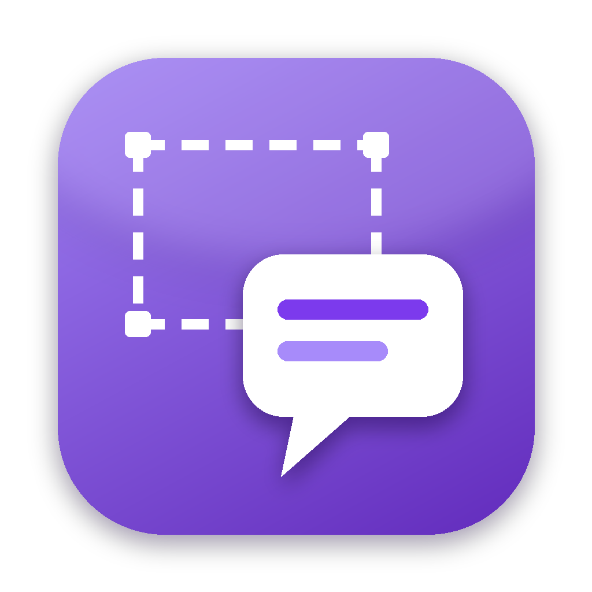

<p align="center"></p>

<h1 align="center">Remark</h1>

A menu-bar reviewer for macOS. Hit a shortcut, drag over any part of the screen (or highlight some text), then type or talk a note. Every note lands in a local **review session** that becomes a clean report you can send to anyone. It doesn't need Google Docs, edit access, or the other person's tool.

Use it for app/onboarding walkthroughs, bug bounty evidence, design feedback, doc review, or anything else you're looking at on screen.

## Shortcuts (defaults, all changeable in Settings)

| Keys | Action |
|---|---|
| **⌃⌥R** | Capture area & note: drag to select, click (or ↩) for the whole screen, Esc to cancel |
| **⌃⌥T** | Note on selected text: highlight text in any app first |
| **⌃⌥N** | New review session |
| **⌃⌥B** | Show / hide the cursor buddy |
| **⌘,** | Settings (from the menu-bar icon) |

In the note panel: **⌘↩** save · **⌘D** talk/stop · **⌘E** pull text out of the screenshot · **Esc** discard. Tags: Note / Bug / UX / Question / Idea.

## Features

- **Screenshot notes**: select an area and annotate it. Text in the capture can be extracted on-device (Vision OCR), on demand or automatically.
- **Text notes**: highlight text in any app (docs, PDFs, browsers, code) and comment on it. The quote is kept with your note. It uses the Accessibility API and falls back to a copy round-trip that restores your clipboard.
- **Talk or type**: dictation through Apple's Speech framework, on-device when supported.
- **Cursor buddy**: during a session, a small purple pointer trails your cursor with a running note count. It turns red with a mic icon while you're dictating.
- **Context**: each note records the app and window title it came from.
- **Export** (menu → Export): PDF (A4 or Letter, rendered natively), single-file HTML, Markdown + images (.zip), JSON, CSV.
- **Settings**: record any shortcut combo, choose a cursor style, open at login, and check permissions at a glance.

Sessions live in `~/Documents/Remark/<date>-<name>/` (`session.json`, `shots/`, `report.html`, `report.md`).

## Install

Download the latest `Remark-x.y.z.dmg` from [Releases](../../releases), open it, and drag **Remark** into **Applications**.

> Builds that aren't notarized get blocked by Gatekeeper the first time. Open **System Settings → Privacy & Security** and click **Open Anyway**, or run `xattr -dr com.apple.quarantine /Applications/Remark.app`.

## Build from source

Requires the Xcode Command Line Tools (`xcode-select --install`) and macOS 13+.

```bash
./build.sh install    # build, copy to ~/Applications, launch
./build.sh dmg        # build/Remark-<version>.dmg
./build.sh release    # DMG + push + GitHub release (needs gh)
```

Notarized builds: with a *Developer ID Application* certificate in your keychain, `build.sh` signs with the hardened runtime automatically. Set `REMARK_NOTARY_PROFILE` (from `xcrun notarytool store-credentials`) and it notarizes and staples the DMG.

### Permissions

| Permission | Why |
|---|---|
| Screen Recording | Screenshot notes (relaunch after granting) |
| Accessibility | Reading selected text for text notes |
| Microphone + Speech Recognition | Talk |

`build.sh` signs with the best certificate it finds (Developer ID → Apple Development → ad-hoc). Signing with a real certificate keeps permissions across rebuilds.

## Roadmap ideas

- Screen recording clips per note (ScreenCaptureKit `SCRecordingOutput`)
- Arrows/boxes/redaction on screenshots (redaction matters for bug bounty PII)
- Session viewer: edit/reorder/delete notes
- Report templates: HackerOne/Bugcrowd, client UX audit
